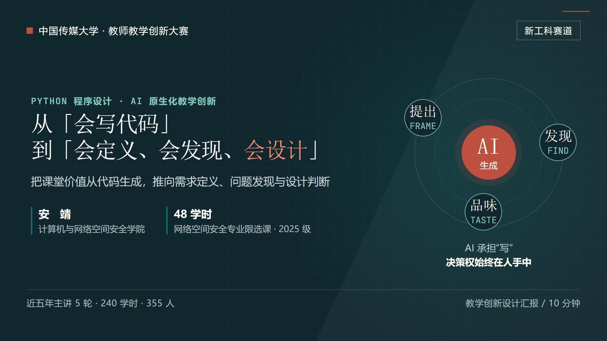

  第七届中国传媒大学教师教学创新大赛 · 新工科
  <h1>从「会写代码」 到「会定义、会发现、会设计」</h1>
  
《Python 程序设计》48 学时整门课程重构：把课堂价值从代码生成，推向需求定义、问题发现与设计判断。

  

    <a class="ti-primary" href="/courses-wiki/innovation-report/">打开交互式汇报 ↗</a>
    <a class="ti-secondary" href="/courses-wiki/python/">进入 Python 课程主页</a>
  

## 汇报依据

> 现场汇报以教学创新设计汇报为主。参赛教师结合教学大纲和教学实践，全面说明整门课程的设计思路，
> 突出教学改革与创新，展示相关过程性支撑资料。汇报时间不超过 10 分钟。
>
> —— 本科生院〔2026〕63号

在线汇报为 **14 页主线 + 3 页答问备查**，主讲约 **9 分 30 秒**。主线沿着“为什么改 — 改成什么 — 怎么实施 —
证据到哪一步”展开，备查页提供三项能力测量设计、材料来源与评分维度覆盖关系。

## 三项能力

  
<b>提出需求</b>把模糊任务变成可执行、可验证的规格：用户与场景、输入输出、边界、失败路径、验收标准与关键取舍。

  
<b>发现问题</b>面对 AI 生成结果，定位缺陷、识别需求遗漏与安全风险，说明后果、判断优先级并完成修复。

  
<b>设计品味</b>在多个“能跑”的方案之间比较结构、接口、可维护性、安全与成本，做出与场景匹配、理由清楚的取舍。

三项能力落到整门课程的目标、内容、五步循环与过程性评价中，详见
[M0 课程导论](/courses-wiki/python/v2/m0/)。它们仍是本轮课程要持续观测的目标，不把设计写成已完成的学习成效。

## 整门课程设计

  
<b>48 学时 · 8 个模块</b> 对照课程教学大纲重排 M0–M7：工具性内容做减法，AI 应用开发与综合项目做加法，总学时不变。

  
<b>一门课的整体设计</b> 目标、内容、教学法、环境、评价与课程思政同向调整，而不是在旧课上追加一个 AI 工具演示。

  
<b>AI 结对开发</b> 提出需求 → AI 生成 → 发现问题 → 运行验证 → 设计迭代；AI 承担“写”，人保留定义、判断与设计权。

  
<b>过程性评价</b> 分支提交、逐份批注、协作日志、课堂小测与随机抽行答辩，让“如何形成判断”留下可核验的痕迹。

模块索引：
[M0 导论](/courses-wiki/python/v2/m0/) ·
[M1 环境与工具链](/courses-wiki/python/v2/m1/) ·
[M2 语言核心](/courses-wiki/python/v2/m2/) ·
[M3 数据获取与处理](/courses-wiki/python/v2/m3/) ·
[M4 工程化](/courses-wiki/python/v2/m4/) ·
[M5 AI 应用开发](/courses-wiki/python/v2/m5/) ·
[M6 综合项目实战](/courses-wiki/python/v2/m6/) ·
[M7 总结与展望](/courses-wiki/python/v2/m7/)

## 课程网站本身即过程性支撑

课程网站不是汇报附件或展示橱窗，而是本次课程改革的组成部分：每周课件、模块页、运行场、测验、
互动演示与任务说明都在同一套课程结构中持续迭代、公开留痕。

  
<b>16 周交互课件</b> <a href="/courses-wiki/python/v2/slides/w01.html">查看 W01 示例</a>，每周课件与模块页、课堂活动相互对应。

  
<b>88 篇课程笔记</b> <a href="/courses-wiki/python/v2/notes-index/">按主题索引</a>，保留课程迭代过程中的讲解、示例与答疑。

  
<b>4 个交互演示</b> <a href="/courses-wiki/python/demos/interpreter.html">解释器</a> ·
     <a href="/courses-wiki/python/demos/objects.html">对象</a> ·
     <a href="/courses-wiki/python/demos/base64.html">Base64</a> ·
     <a href="/courses-wiki/python/demos/rag.html">RAG</a>，把抽象概念变成可操作对象。

  
<b>可核验的课程结构</b> <a href="https://github.com/anjingcuc/courses-wiki">GitHub 仓库</a>保留内容演进，
     课程网站与汇报材料使用同一批课程事实。

<b>证据边界：</b>课程网站、两学时教案、阶段作业提交与批注、小测反馈，能够支撑“课程设计与教学实施已经发生”；
但它们不能单独证明三项能力提升、终结性项目表现或外部采用效果。三项能力的三次等值测量仍是后续评价设计，
不是既有成效数据。

## 现场材料与可复现构建

- 汇报课件源码：`teaching-innovation-deck/`
- 构建入口：`python scripts/build_teaching_deck.py`
- 发布流程：push 到 `master` → GitHub Actions 构建课件到 `docs/innovation-report/` → MkDocs 发布到 GitHub Pages
- 交互式汇报直达：[https://anjingcuc.github.io/courses-wiki/innovation-report/](https://anjingcuc.github.io/courses-wiki/innovation-report/)

课件中的 API 请求与代码审查为离线教学模拟，不调用真实服务，也不伪装成学生真实作答数据。

